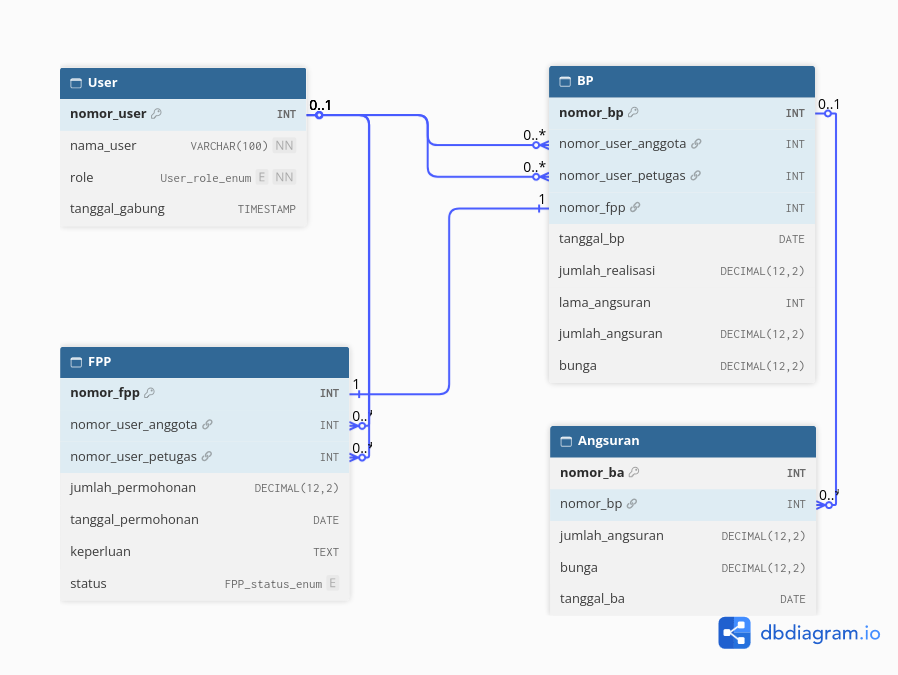

# Koperasi FKOM - Loan Management Database Architecture (MySQL)

Proyek ini merancang sistem relasional untuk koperasi simpan pinjam, menagani alur permohoan hingga angsuran bulanan.

- Role_Based Access Control (RBAC) pada tabel User.
- Data Integrity menggunakn `FOREIGN KEY` dengan `ON DELETE RESTRICT`.
- Automated Business Logic menggunakan `STORED PROCEDURE`.
- ACID Transactions (`COMMIT` & `ROLLBACK`) untuk mencegah pencatatan hutang ganda.
- Executive Reporting menggunakan `VIEW` dan `COALESCE` untuk penanganan Null.

Jalankan script di folder `src/` secara berurutan.